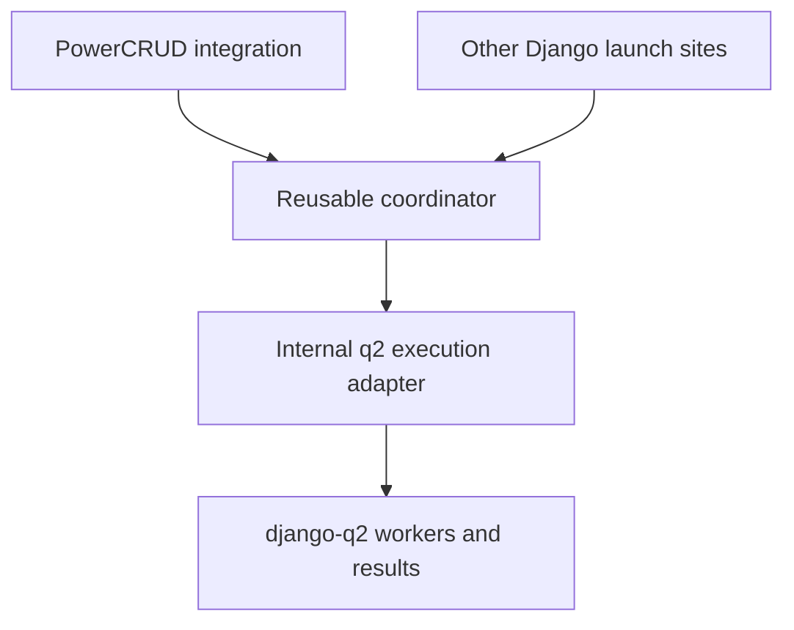
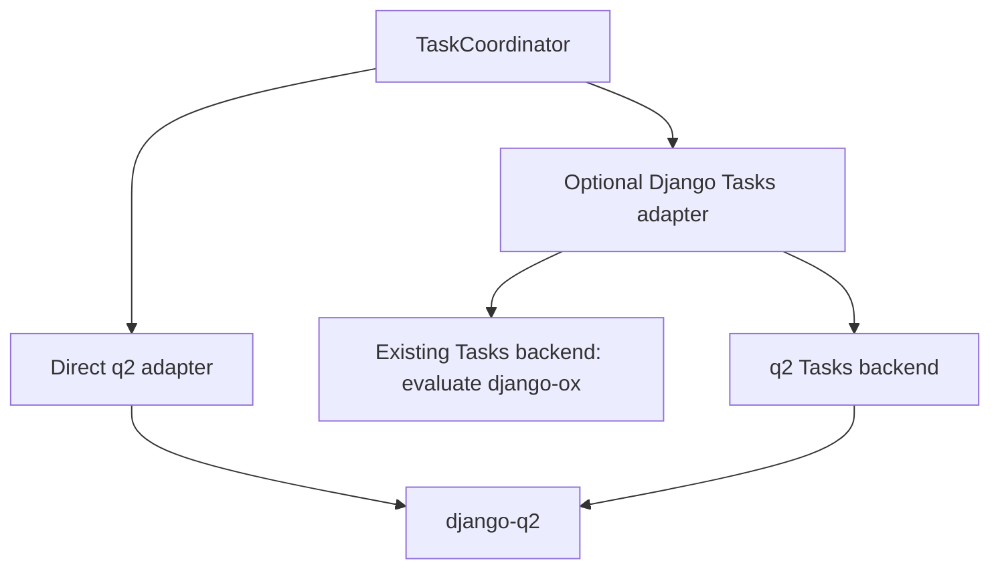

# Async hardening discussion and decisions

Discussion captured on 2026-11-04. These are temporary engineering notes; stable behavior belongs in `docs/mkdocs/` once implemented and verified.

## Agreed direction

AsyncManager and its supporting infrastructure have value outside PowerCRUD. The intended standalone offering coordinates background jobs: conflict locks, progress, lifecycle events, optional persistent records, and cleanup. It initially continues to use django-q2 for execution.

The existing separation is meaningful but incomplete. Arbitrary workers and application-owned dashboard models are supported, while settings, queue details, HTTP polling, hook paths, and manager reconstruction still cross boundaries. The current work establishes strict internal separation, hardens behavior, and then extracts and integrates the standalone package.

`django-task-coordinator` and `TaskCoordinator` are provisional names. They describe background-task coordination more clearly than Python `async`/`await`; package-name availability and final naming remain undecided. Current public names need not change during internal separation.

The full roadmap is in [master.md](master.md). Following the scope update, this folder's executable plan covers **step 1: hardening**, **step 2a: internal separation**, and **step 2b: full standalone package extraction and PowerCRUD integration**. django-q2 remains the only execution backend. Changing the execution engine, adding Django Tasks, building a q2 Tasks backend, and redesigning the dashboard UI remain outside scope. Phase A's contracts, audit, and test infrastructure are complete; production implementation and external release actions remain subsequent work.

## Ownership boundary

| Reusable coordinator | q2 execution adapter | PowerCRUD integration |
|---|---|---|
| Locks, task state, progress, lifecycle, context, manager reconstruction | Lazy dependency access, queue configuration, enqueueing, result retrieval, completion translation | Bulk thresholds, selection, CRUD workers, persistence behavior |
| Optional model tracking and reconciliation | q2 execution identifiers and options | Conflict responses, locked-row presentation, progress modal, dashboard CRUD views |
| Optional reusable progress endpoint and cleanup entry points | q2-specific health checks and scheduling integration | Mapping PowerCRUD settings into coordinator configuration |

The coordinator can still use Django infrastructure. Strict separation means one-way dependencies and independently testable behavior; its implementation must not reach back into PowerCRUD configuration helpers or CRUD components. Framework-facing endpoints should be separable from the coordination service. `ModelTrackingAsyncManager` and its configuration fit the reusable scope; the sample dashboard's CRUD views stay with PowerCRUD.

No general backend plugin system is required now. Establish a narrow boundary around the existing q2 dependency, preserving compatibility where practical.

## Key Async Hardening Issues

[Issue #34](https://github.com/doctor-cornelius/django-powercrud/issues/34) covers lazy django-q imports, delayed queue settings access, graceful inactive behavior, targeted configuration errors, misconfiguration tests, and documentation. Its comment also proposes Django Tasks and presentation improvements; those are deferred here.

This table is the complete hardening register: it includes every requirement in the body of issue #34 plus the additional review findings. The Django Tasks and presentation proposals in the issue comment remain deferred. Numbers are stable references used by the plan; append new issues rather than renumbering existing entries. 🔳 means incomplete; change it to ✅ only when the outcome and relevant verification are complete, recording evidence in these notes. Phase completion alone does not close an issue that still needs later integration verification.

The additional findings originated in read-only inspection. [A2](phase_A/phase_A_a2_results.md#2-findings-113) records their qualifications and evidence limits, and [A1](phase_A/phase_A_notes.md#a1-draft-contracts-for-discussion) records the settled contracts. Inspection does not by itself establish a failing runtime reproduction or a completed production fix.

| No. | Done | Area / source | Current observation | Required investigation or outcome |
|---|---|---|---|---|
| 1 | 🔳 | Optional dependencies (#34 §2.1) | `async_manager.py` imports q2 models/functions at module load; `AsyncMixin` imports the manager before its dependency checks. | Load/cache q2 dependencies lazily through a helper; dormant imports stay safe and explicit use without q2 produces a friendly targeted error. |
| 2 | 🔳 | Configuration (#34 §2.2, plus review) | `validate_async_configuration()` is a placeholder; settings/cache/queue initialization can fail before a useful validation result. | Delay `Q_CLUSTER` access until settings are configured and async is explicitly used; validate settings shapes, installed apps, cache capabilities, and queue setup with targeted early-use errors. |
| 3 | 🔳 | Enablement (#34 §2.3, plus review) | Docs disagree about `ASYNC_ENABLED`; launch paths do not enforce it while scheduled/command cleanup checks it. | Define consistent manager/mixin behavior when disabled or dependencies are missing, explicit-launch versus view fallback rules, and clear inactivity logs; do not strand existing tasks by disabling cleanup. |
| 4 | 🔳 | Misconfiguration coverage (#34 §2.4) | Minimal-settings coverage exists, but the issue calls for broader negative-path coverage. | Verify missing/wrong `POWERCRUD_SETTINGS`, unconfigured settings, absent/partial q2 setup, and invalid cache/queue configuration yield clean local failures; cover dormant sync usage independently. |
| 5 | 🔳 | Documentation and examples (#34 §2.5, plus review) | Enablement guidance conflicts; general examples reserve under `custom-task` and then launch with the same conflict IDs under another identifier. | Clarify sync-by-default/async-opt-in behavior in README and guides, document minimal-settings test commands, add release notes, and fix examples to reserve once and pass required worker arguments consistently. |
| 6 | 🔳 | Status (review) | Cache-only status treats missing progress as completed; the generic endpoint reports successful completion from that state. | Keep missing/expired/unknown distinct from explicit terminal outcomes and preserve failure information for polling. |
| 7 | 🔳 | Operation failure (review) | Bulk workers catch exceptions or failed operations and return `False`; completion interprets the queue execution-success flag. | Keep business-operation failure visible even when a function returned normally; retain useful result/error details. |
| 8 | 🔳 | Launch ordering (review) | Enqueue precedes active registration and `create`; active registration creates pending progress again. | Fast or synchronous completion cannot be undone by late registration, progress reset, or lifecycle events. |
| 9 | 🔳 | Concurrent registry (review) | Active-task membership uses shared-set read/modify/write. | Concurrent launches and completions cannot lose unrelated entries. |
| 10 | 🔳 | Lock lifecycle (review) | Per-object acquisition uses `cache.add`, but release deletes tracked keys without checking ownership and the wider sequence is not atomic. | Cover expiration/reacquisition, ownership-safe release, partial failures, tracking updates, and repeated descendant registration. |
| 11 | 🔳 | Reconciliation (review) | Missing q2 `Task` rows trigger cleanup without an age/queue-state distinction; the legacy `cleanup_active_tasks()` clears all registered tasks. | Establish safe reconciliation and explicit force-cleanup semantics; missing result rows alone do not prove abandonment. |
| 12 | 🔳 | Manager identity (review) | Direct custom-manager launches depend on caller-supplied reconstruction metadata; descendant helpers instantiate the base manager; resolution can silently fall back. | Preserve identity/configuration across all paths and make invalid explicit configuration observable. |
| 13 | 🔳 | API boundaries (review) | q2 options/types, PowerCRUD settings/prefixes/URLs, and hardcoded hook paths appear in the manager; a trailing UUID argument is interpreted as a task identifier. | Separate queue transport and app integration, and explicitly account for existing compatibility behavior. |

Relevant implementation: `src/powercrud/async_manager.py`, `async_hooks.py`, `async_context.py`, `async_dashboard.py`, `tasks.py`, `schedules.py`, `conf.py`, `mixins/async_mixin.py`, and `management/commands/pcrud_cleanup_async.py`.

Existing coverage includes `src/tests/async_tests/test_sys_functions.py`, `test_async_mixin_extended.py`, `test_async_hooks.py`, `test_async_context.py`, `test_minimal_settings_no_async.py`, and `src/sample/tests/test_async_samples.py`. Reuse and strengthen behavioral coverage rather than testing incidental helper structure.

## Sample demonstration coverage matrix

Read-only audit completed on 2026-11-04 across sample views/models/services/backends, async and CRUD tests, default/Bootstrap/minimal settings, Playwright coverage, and sample/async guides. “Evidence” records inspected coverage, not executed tests. The status means the scenario was audited; follow-up acceptance work remains open.

| ID | Intended demonstration | Existing implementation and user entry | Inspected evidence and limits | Owner / phase | Gap and follow-up acceptance | Hardening issues | Audit |
|---|---|---|---|---|---|---|---|
| D1 | Queue bulk update and delete only at the configured selection threshold; show progress and successful completion. | `BookCRUDView` and `PowerFieldBookCRUDView` enable async at 2 selected records; Book delete sleeps to make duration visible. `AsyncTaskRecordCRUDView` points users from task list to progress. | Async mixin unit tests cover thresholds and launch payload; Playwright covers bulk selection, but async template-pack test checks the queued fragment only. No browser flow launches update/delete, waits for worker completion, and observes the dashboard. The q2 end-to-end-named test mocks enqueue to invoke the worker inline. | PowerCRUD sample / D, with execution contract in package / F | Keep one clear sample path for update and delete, with repeatable setup/run instructions and observable queued → progress → success behavior. Add real worker/browser coverage only if the full stack can deterministically exercise it; label inline/mock tests accurately. | 4, 6–8, 13 | ✅ |
| D2 | Prevent overlapping work and show locked records/actions until safe release. | Book rows use lock-sensitive normal Edit action; inline lock metadata and CRUD conflict handling consume manager state. | Unit tests cover conflict primitives, mocked single-record conflicts, inline locked responses/metadata, and async delete short-circuit. No user flow visibly holds a real job open, attempts overlapping bulk/single edits, then verifies unlock after completion. | PowerCRUD sample / D; coordinator lock contract / C | Reuse delayed book operation to show lock-sensitive action and one conflicting edit while running, then verify the row becomes editable after completion. Cover stale/expired locks in coordinator tests, not a UI-only demo. | 8–11 | ✅ |
| D3 | Show the same business validation failure in synchronous and queued bulk update paths. | `Bulk Validation Sample Book` refuses bestseller promotion; `BookBulkUpdateService` is shared by sync hook and async backend. Page help explains below/at-threshold outcomes. | Sample tests cover service payload, backend propagation, mocked `bulk_update_task` failure/progress, and synchronous modal rerender. No browser test verifies async dashboard failure details; synchronous and async user feedback intentionally differ. | PowerCRUD sample / C,D | Keep the existing scenario; document steps and expected outcomes. Verify the synchronous modal retains validation detail and the queued path records a truthful failed outcome and useful error in dashboard/progress after lifecycle hardening. | 5–7 | ✅ |
| D4 | Show parent task context, descendant locks, and progress propagation without launching nested work. | `Book.save()` detects task context, registers related Genre IDs, and reports child progress; outside context it follows ordinary save behavior. | Sample tests mock `task_context`, conflict registration, manager, and sleep; they prove branching and calls but not lock visibility or actual nested execution behavior. | PowerCRUD sample / D; generic context API / package | Keep a concise sample explanation and focused sample test. Package tests own context isolation, manager reconstruction, and descendant registration semantics; add an end-to-end descendant lock demo only if users can meaningfully observe it. | 10, 12–13 | ✅ |
| D5 | Show dashboard lifecycle, custom manager, progress detail, success/failure, and cleanup metadata. | `SampleAsyncManager` tracks `AsyncTaskRecord`; async tasks list/detail and View Progress action expose state. | Tests cover create/progress/complete/fail/cleanup persistence, formatting, and detail rendering. Playwright test only checks async row-action icon layout using a pre-created successful row; it does not poll a live task. Filter/time tests exercise dashboard filters and display formatting. | PowerCRUD sample / D; reusable tracking contract / package | Retain dashboard as the PowerCRUD integration example. Add a user-driven launch/progress/terminal display path and verify DaisyUI plus Bootstrap rendering. Generic model tracking tests move to package suite; rendered CRUD dashboard remains consumer coverage. | 6–8, 12–13 | ✅ |
| D6 | Explain manual/scheduled cleanup and demonstrate stale task reconciliation safely. | `pcrud_cleanup_async`, `cleanup_async_artifacts`, and q2 schedule entry point call manager cleanup. | Tests cover disabled scheduling and command output; manager tests mock completed/running task rows and check artifact removal. No demonstrated abandoned-worker case establishes when locks may safely be reclaimed. | Cleanup CLI/integration ownership decided in A1; reusable behavior / package, wrapper / PowerCRUD | Do not create a user-facing cleanup demo claiming abandoned recovery until reconciliation semantics settle. Acceptance is truthful command report output and a test distinguishing running, completed, absent, and stale work; document manual command and scheduling. | 3, 5, 11, 13 | ✅ |
| D7 | Keep synchronous PowerCRUD usable under minimal settings; validate async setup differences automatically. | `tests.settings_minimal` removes django-q, `POWERCRUD_SETTINGS`, and async cache config while retaining PowerCRUD/sample. Bootstrap inherits async-enabled defaults and changes presentation settings. | Minimal-settings tests cover imports and sync form/bulk-delete paths. `tests.settings` configures q2 sync mode and file-based caches; it is not proof of separate worker execution. `tests.settings_bootstrap` inherits that config. | PowerCRUD configuration tests / C,D; package config tests / A,E | Use automated settings/process tests rather than sample screens for missing/wrong settings, package absent, q2 absent/in `INSTALLED_APPS` mismatch, cache variants, and import-before-settings. Verify Bootstrap only for presentation parity, not a distinct async backend/configuration. | 1–5, 13 | ✅ |
| D8 | Demonstrate ordinary background work using the extracted coordinator without PowerCRUD. | No standalone implementation or sample app currently exists. Async Manager guide contains a custom callable example, but imports PowerCRUD's manager. | Documentation example is not an independent runnable proof; current async tests import PowerCRUD/sample code. | Standalone package example / E,F | Deliver one small independently runnable Django example (recommended: a non-CRUD maintenance task with progress and lifecycle/tracking) using the installed package and q2. Include setup, launch, observe, and cleanup instructions; ensure its tests/settings do not install PowerCRUD/sample. | 1–4, 12–13 | ✅ |

The audit confirms a good sample foundation; additions should focus on observable successful execution and truthful terminal feedback. Do not add a screen for every settings permutation. Use isolated automated settings/process tests for configuration and dependency variants, and treat a real worker/cache as a separate integration proof.

## Work size and delivery

The full scope is substantial: it combines correctness work around shared state and worker timing, internal separation, an independently maintained distribution, and compatibility migration. Establishing the boundary is smaller than proving lifecycle and locking guarantees and verifying the extracted artifact. Treat Phases A–F as incremental reviewable changes, not one large refactor. No reliable calendar estimate is established; reproduction results, supported cache guarantees, compatibility decisions, and repository/release setup will determine the effort.

## Test Ownership Review

Reviewed existing test definitions, representative bodies, worker helpers, test settings, shared fixtures, and runner configuration on 2026-11-04. This was read-only inspection; no tests were executed. Coordinator test ownership must be separated early in Phase A, before the structural changes in Phase B, and maintained throughout hardening and extraction.

| Current location / coverage | Future owner | Required separation |
|---|---|---|
| `src/tests/async_tests/test_sys_functions.py`: `TestActiveTasks`, `TestConflictDetection`, `TestAtomicReservation`, `TestConcurrentAccess`, `TestTask3LaunchPattern`, `TestTask3ActiveTasksIntegration`, `TestTask3ProgressIntegration`, `TestTask3StatusMethods` | Coordinator core, with q2-specific assertions in its adapter tests | Split by behavior; replace sample model/manager dependencies and old module patch paths. Retain behavioral assertions while correcting intentionally changed contracts. |
| Same file: `TestSysFunctions`, `TestCleanupUtilities`, `TestTask3CompletionHooks`, `TestAsyncHookHelpers`, `TestTask3EndToEndIntegration` | Coordinator core and q2 adapter/integration suite | Separate generic state/lifecycle assertions from q2 result translation, dependency loading, and actual worker execution. Cleanup scenarios need realistic absent-result and running-task cases. |
| Same file: `TestProgressPolling`, `TestModelTrackingAsyncManager` | Coordinator's optional Django endpoint/model-tracking modules | Supply package-owned URL configuration and a minimal tracking test model instead of `sample.AsyncTaskRecord`; keep PowerCRUD-rendered pages in consumer coverage. |
| Same file: `DummyConflictView`, `TestSingleRecordConflicts`, `AsyncMixinManagerResolutionTests` | PowerCRUD integration | Keep CRUD conflict rendering and view/global configuration precedence here, testing the coordinator's public contract. |
| `src/tests/test_async_context.py` | Coordinator context/locking tests | Replace `sample.Book` model-resolution dependency with a minimal test model and verify configured manager propagation and descendant registration. |
| `src/tests/test_async_hooks.py` | Coordinator q2 hook/progress helper tests | Move with supporting helpers; consolidate overlap with `TestAsyncHookHelpers` after checking that distinct cases remain covered. |
| `src/tests/async_tests/workers.py` | Coordinator q2 integration support | Keep worker functions importable by child processes; remove PowerCRUD imports when the production boundary permits and avoid silently masking failures in tests intended to prove progress. |
| `src/tests/test_async_mixin_extended.py` | PowerCRUD integration | Keep threshold/queue decisions, manager configuration selection, queue failure responses, and bulk persistence metadata here. |
| `src/tests/test_powercrud_tasks_and_utils.py` | Split | Keep bulk update/delete workers, persistence delegation, help commands, and PowerCRUD URL wiring here. Move reusable scheduler behavior with coordinator tooling; retain PowerCRUD compatibility-wrapper tests if wrappers remain. Split its module-wide transaction monkeypatch away from unrelated tests. |
| Async cleanup cases in `src/tests/test_management_commands.py` | Split | Test package-owned cleanup command behavior in the coordinator suite; keep any legacy `pcrud_cleanup_async` wrapper/setting translation tests in PowerCRUD. Do not move unrelated command coverage. |
| `src/tests/test_minimal_settings_no_async.py`, `test_conf_logging_validators.py` | PowerCRUD, plus new independent coordinator configuration tests | Keep synchronous CRUD/template/default-setting assertions here. Add coordinator early-import and misconfiguration coverage using isolated settings/processes rather than copying PowerCRUD assertions. |
| `src/sample/tests/test_async_samples.py`: `SampleAsyncDashboardTests`, `SampleAsyncContextDemoTests` | PowerCRUD sample integration, with generic contracts covered independently in coordinator | Keep sample manager formatting, model-save integration, and rendered dashboard detail coverage here; use minimal package-owned models for reusable lifecycle tests. |
| Same sample file: form dependencies, tutorial services/backends, guards, bulk validation; `test_inline_editing_mixin.py` lock metadata; presentation/browser coverage | PowerCRUD/sample integration | Keep domain persistence, CRUD permissions/affordances, locked-row display, and DaisyUI/Bootstrap behavior here; these are consumers of coordination. |

### Test layout and independence

Initially keep future package tests in a dedicated repo-local tree such as `src/coordinator_tests/`, outside `src/tests/` so they do not inherit PowerCRUD's `conftest.py`. Keep consumer tests in `src/tests/` and `src/sample/tests/`. The coordinator tree should group core behavior, q2 adapter behavior, optional Django integrations, and actual worker/cache integration. This location is provisional; the ownership boundary is the requirement.

Give the coordinator suite its own settings, URLs, fixture scope, minimal test app/models, and top-level worker helpers. During the internal stage it necessarily imports the coordinator's current `powercrud` module paths, but it must not depend on CRUD/sample imports, sample models, or PowerCRUD app installation once Phase B establishes the boundary. At extraction, move this suite with the implementation and update its import/patch paths; keep PowerCRUD contract tests here against the installed distribution. Avoid a permanently duplicated coordinator suite.

The root `pytest.ini` selects `tests.settings` and `--cov=powercrud`; directory separation alone will not make the suite independent. Provide explicit suite configuration/runner selection and coverage targets, maintain discovery of both suites in `runtests` and CI, and verify they run separately. For missing-dependency and settings-not-configured cases, use genuinely isolated processes/environments; removing an app from `INSTALLED_APPS` does not prove a distribution is absent.

### Observed fixture and evidence limitations

These describe the pre-A3 baseline. The [A3 ledger and dependency record](phase_A/phase_A_a3_results.md#relocation-ledger) identify the current test locations, replaced fixtures, and remaining production dependencies.

- `test_sys_functions.py` imports `AsyncMixin`, sample models, and `SampleAsyncManager` at module scope, coupling otherwise reusable tests to CRUD and the sample app.
- `tests.settings` installs the full PowerCRUD/sample stack, configures file-based caches, and sets `Q_CLUSTER['sync'] = True`. `tests.settings_minimal` removes q2 from installed apps but still installs PowerCRUD/sample and does not prove q2 is uninstalled.
- `src/tests/conftest.py` clears shared caches before/after every test, while `AsyncManagerTestMixin` also clears its entire cache. Replace inherited cleanup with suite-owned isolated aliases/namespaces and explicit resource cleanup before introducing concurrent tests.
- `TestConcurrentAccess.test_concurrent_atomic_reservation` explicitly performs sequential attempts. It verifies conflict behavior, not simultaneous interleavings. The cache-add test is sequential too; neither proves cross-process atomicity of the configured backend.
- `TestTask3EndToEndIntegration.test_e2e_launch_execute_cleanup_cycle` starts from a cluster-enabled base but patches enqueueing to call the worker inline. Keep useful mocked coverage, label it accurately, and add actual worker/completion integration separately; qcluster probe coverage is not a full lifecycle proof.
- Some existing assertions encode behavior under review, including clearing all active tasks and current manager fallback/status semantics. Preserve baseline coverage during the structural split, then update expectations with explicit regression cases when contracts change.

Add genuine synchronized concurrency, ownership-expiry/reacquisition, fast/synchronous completion, missing-result reconciliation, failure preservation, and installed-artifact checks in the owning suite as their hardening work proceeds. File names or test counts alone do not establish those guarantees. These test changes support hardening issues 1–13, especially coverage issue 4 and boundary issue 13; they are not a separate feature expansion.

## Plan Phases

These are cross-phase summaries. Elaborate working detail in phase folders as they become active; [Phase A notes](phase_A/phase_A_notes.md) hold the current phase detail. The numbered hardening register above remains the single shared completion checklist.

### Phase A: Define ownership and behavior

**Complete on 2026-11-04.** Contracts are settled, findings and support claims are qualified, sample scenarios are audited, and the reusable suite has been separated and verified. See the completion record below; production hardening remains in later phases.

#### Phase A completion and handoff

Use this section as the cross-phase entry point. Keep detailed decisions/evidence in `phase_A/`, the numbered issue register and D1–D8 matrix in this file, and implemented testing instructions in the [stable testing guide](../../mkdocs/reference/testing.md). No additional master-level report is needed.

| Record | What later phases should take from it |
|---|---|
| [Agreed A1 clauses C1–C6 and resolved Q1–Q10](phase_A/phase_A_notes.md#a1-draft-contracts-for-discussion) | Authoritative behavioral requirements, compatibility commitments, scope exclusions, acceptance scenarios S1–S6, and owners. These are agreed requirements, not implemented guarantees. |
| [A2 results and review corrections](phase_A/phase_A_a2_results.md) | Qualifications for all 13 issues, supported-configuration claims, launch/context findings, missing proofs, and test ownership. The earlier [audit](phase_A/phase_A_audit.md) is historical supporting evidence. |
| [A3 relocation ledger](phase_A/phase_A_a3_results.md#relocation-ledger) | Every old/new node and helper replacement; 63 reusable cases moved, 11 consumers retained/accounted for. Use pre-A3 commit `6172d501` for historical test-source references. |
| [Non-coverage review](phase_A/phase_A_noncoverage_review.md) | Requirement-by-requirement assessment, selection repairs, and confirmation that all 74 original cases and 232 assertions remain accounted for. |
| [Final coverage/verification follow-up](phase_A/phase_A_coverage_results.md) | Final artifact layout, removed workaround, real artifact proofs, and fresh full server results: 114 coordinator passes; 1,055 consumer passes/23 skips; four minimal and 31 Bootstrap passes. |

Carry these requirements into subsequent plans:

- **Phase B:** isolate q2 and make coordinator configuration explicit while preserving established behavior. Current `powercrud` imports, configuration/logging helpers, `POWERCRUD_SETTINGS`, hook paths, and namespaces remain documented dependencies to remove/adapt. Keep compatibility consumers in PowerCRUD; move adapter patch targets when the implementation actually moves.
- **Phase C:** implement the agreed outcomes with intentional regression changes. Missing-progress success, invalid-manager fallback, and current cleanup/order expectations remain preserved baseline behavior. Do not treat their passing tests as contract compliance or silently change them during Phase B.
- **Backend guarantees:** preserve currently claimed cache/q2 support, including Redis, Memcached, DatabaseCache, and relevant broker/result-storage combinations. File caches, synchronous probes, mocked hooks, and sequential reservations do not certify concurrency or real workers. q2 1.11.1 source inspection does not certify the entire allowed version range; return concrete feasibility limits for agreement.
- **Scope commitments:** new retry features, durable orchestration/replay, guaranteed notifications, and rolling in-flight upgrades remain excluded under Q6–Q10. Commit-safe submission, owner-safe locking/recovery, truthful outcomes, terminal retention, and compatibility/drained upgrades remain required. Keep the detailed contracts in A1 as the source of truth.
- **Phases D–F:** retain sample/domain/presentation assertions and follow the existing D1–D8 owners/acceptance. Prove actual worker/result modes, concurrency, absent dependencies, and installed-package use in their assigned phases. Move the coordinator suite with extraction rather than duplicating it.
- **Verification:** keep the two settings environments/processes separate and put new tests in their owning suite. Runner selections and coverage are now stable and documented. Phase A ran no browser tests or CI workflows and makes no claim that those passed.

Phase A completion closes the preparation/test-separation phase only. Hardening-register issues 1–13 stay open until their production outcomes and relevant later verification are complete. The next action is to prepare Phase B documents. Package naming and publication decisions remain assigned to Phase E.

### Phase B: Establish the internal boundary

Start with a small structural change around q2 access and explicit coordinator configuration. Preserve established behavior where possible and distinguish structural refactoring from intentional corrections. PowerCRUD should adapt its settings into the coordinator and consume the public contract; reusable code should not import CRUD components. Completion hooks must remain importable by workers.

### Phase C: Harden configuration and lifecycle

Fix confirmed behavior within the boundary, in focused changes with regression tests. Cover early/unconfigured imports, absent/partial q2 setup, wrong/missing settings, invalid cache configuration, enqueue/cache failures, manager reconstruction, application failures, fast completion, concurrent registry/lock updates, expiration, and reconciliation. Preserve terminal outcomes and make completion/cleanup safe to repeat. Consider transaction visibility at launch when defining the enqueue contract; do not promise atomic database-and-broker delivery without an implementation that provides it.

### Phase D: Verify separation and document the contract

Prove reusable behavior from an ordinary Django launch site without PowerCRUD views/mixins/templates and prove dormant PowerCRUD imports without the background-task stack. Verify integration through CRUD operations, model tracking, polling, and both DaisyUI and Bootstrap presentation. These checks prepare for extraction; they do not create the standalone package.

Implementation tests must run inside the Django container in the full Compose environment using `runtests`, as required by repository guidance. Phase A's executed baselines and limits are linked in its completion record; later verification must record its own runtime evidence.

Update the stable docs below, minimal-settings test instructions, and release notes to describe verified behavior. Preserve these planning notes until the user requests archival.

### Phase E: Extract the standalone package

Step 2b is included in this plan. The standalone package needs its own settings namespace, packaging, documentation, independent tests, CI, release process, and a non-PowerCRUD usage example. Move the coordinator, q2 execution adapter, context helpers, optional model tracking, reusable progress endpoint, cleanup tooling, and the already separate coordinator test suite together. CRUD workers, presentation, and consumer integration tests stay in PowerCRUD. Avoid introducing a second implementation or duplicate coordinator suite as a permanent source of truth.

Settle package-name availability, final class/module naming, repository ownership/location, license, supported versions, and release destination before project creation. These choices remain open; this planning update does not choose or create a repository or publish a release. Include a repeatable artifact build and release workflow so the result is a maintained open source package rather than a copied module directory.

Plan compatibility imports, configured manager/hook paths, cache namespace transitions, and queued/in-flight work before moving modules. Explicitly decide whether rolling upgrades are supported or deployment requires draining workers; test the chosen migration contract. The extracted package must not import PowerCRUD, including through compatibility shims.

### Phase F: Integrate and verify the extracted package

PowerCRUD should expose the package as an optional background-task dependency and import it only when needed. Verify synchronous PowerCRUD with neither the coordinator package nor q2 installed, and verify background operations against a built and installed coordinator artifact in an isolated environment. A successful sibling-checkout import is insufficient evidence of correct distribution metadata or packaging.

Run standalone package CI independently and exercise the supported Django/Python combinations. Recheck real q2 execution, lifecycle, progress, model tracking, cleanup, migration compatibility, and PowerCRUD's DaisyUI and Bootstrap integrations. Record exact artifact versions and verification results, update installation/migration documentation, and make release/dependency wiring concrete. Resolve external repository/publication decisions when that implementation work begins; backend expansion stays deferred.

## Deferred execution options: step 3

Django Tasks would be an optional coordinator execution adapter. An actual Django Tasks backend, such as django-ox or a q2 integration, sits underneath that API. Adding it does not replace the coordinator's conflict locks, progress messages, dashboard metadata, or reconciliation policy.

For Django 5.2, explicitly use the [`django-tasks` backport](https://github.com/RealOrangeOne/django-tasks); centralize native/backport selection in the future adapter and verify both supported paths. First prove the adapter with an existing backend after assessing its capabilities and deployment requirements. Then assess or contribute to [django-q2 PR #315](https://github.com/django-q2/django-q2/pull/315), rather than starting a competing implementation without investigation. The PR was open when reviewed during this discussion; refresh its state before acting.

Decide later whether direct q2 remains useful after q2 works through Django Tasks. Another task-framework integration is deferred unless a concrete requirement justifies it. Dashboard/polling presentation redesign is also separate from correcting status behavior.

## Reference documents

- [Async architecture and reference](../../mkdocs/reference/async.md)
- [Async Manager guide](../../mkdocs/guides/async_manager.md)
- [Async dashboard guide](../../mkdocs/guides/async_dashboard.md)
- [Django Tasks documentation](https://docs.djangoproject.com/en/6.0/topics/tasks/)
- [django-q2 result persistence](https://github.com/django-q2/django-q2/blob/master/django_q/monitor.py)
